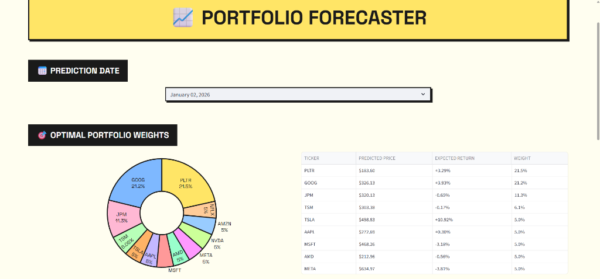
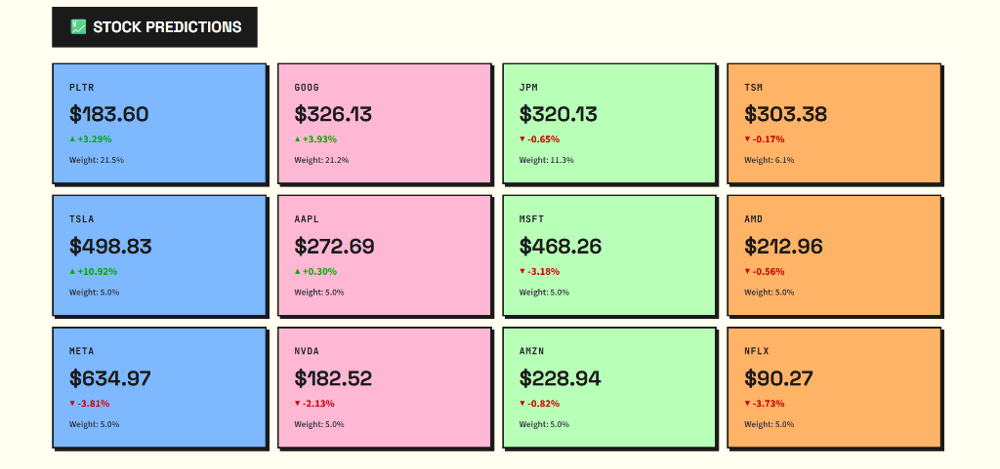

# � GoPred - A Prediction Model

A machine learning project that forecasts stock prices using Facebook's **Prophet** model and optimizes portfolio allocation using **Markowitz mean-variance optimization**.


## 📸 Screenshots

### Dashboard Overview


### Stock Predictions


## 🚀 Quick Start

```bash
# 1. Install dependencies
pip install numpy pandas scipy yfinance scikit-learn matplotlib prophet pandas-market-calendars plotly altair streamlit

# 2. Run the optimization
python -m src.main

# 3. View the dashboard
python -m streamlit run src/streamlit_app.py
# Open http://localhost:8501
```

## ✨ Features

- **Prophet Forecasting** - Predicts next-day stock prices using Facebook's Prophet model
- **Markowitz Optimization** - Calculates optimal portfolio weights using mean-variance optimization
- **Neobrutalism Dashboard** - Bold, high-contrast UI with Streamlit
- **12 Stock Portfolio** - Tracks AMD, MSFT, AAPL, TSLA, AMZN, NVDA, META, GOOG, TSM, JPM, NFLX, PLTR

## 📁 Project Structure

```
├── src/
│   ├── main.py           # Entry point - runs optimization
│   ├── model.py          # Prophet forecasting model
│   ├── optimiser.py      # Markowitz portfolio optimization
│   ├── extractor.py      # yfinance data extraction
│   ├── processor.py      # Data preprocessing
│   ├── settings.py       # Configuration (tickers, risk params)
│   ├── streamlit_app.py  # Dashboard UI
│   └── data/
│       └── predictions.json  # Local storage for results
├── tests/                # Unit tests
├── assets/               # Screenshots
├── pyproject.toml        # Dependencies
└── README.md
```

## ⚙️ Configuration

Edit `src/settings.py` to customize:

```python
# Stock tickers to analyze
PORTFOLIO_TICKERS = ["AAPL", "MSFT", "GOOG", ...]

# Risk parameters
RISK_AVERSION = 5           # Higher = more conservative
MINIMUM_ALLOCATION = 0.05   # 5% minimum per stock
```

## 🧠 How It Works

1. **Data Extraction** - Fetches historical prices via yfinance
2. **Prophet Prediction** - Trains Prophet model per ticker, predicts next-day price
3. **Return Calculation** - Computes expected returns from predictions
4. **Optimization** - Solves Markowitz mean-variance to find optimal weights
5. **Results** - Saves to `src/data/predictions.json` and displays in dashboard

## 📊 Dashboard

The Streamlit dashboard features a **neobrutalism** design:
- Portfolio weights pie chart
- Predicted prices table
- Stock prediction cards
- Historical price trends

## 🔧 Requirements

- Python 3.12+
- prophet
- yfinance
- pandas
- scipy
- streamlit
- plotly

## 📝 License

MIT License
